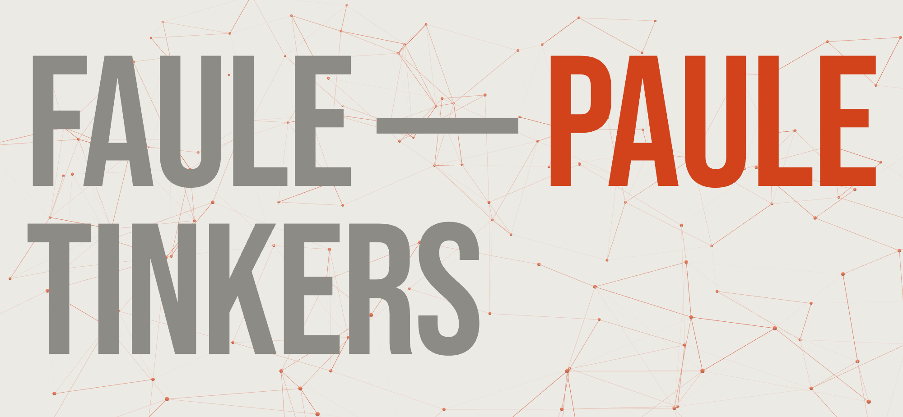
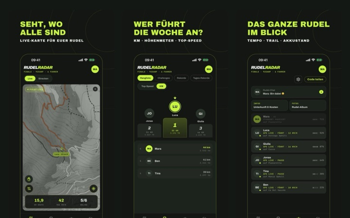
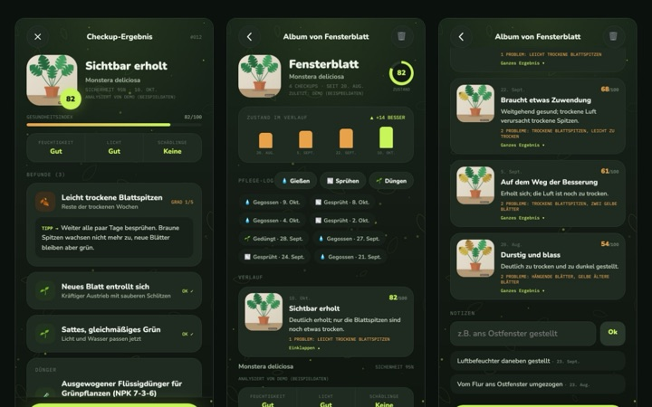
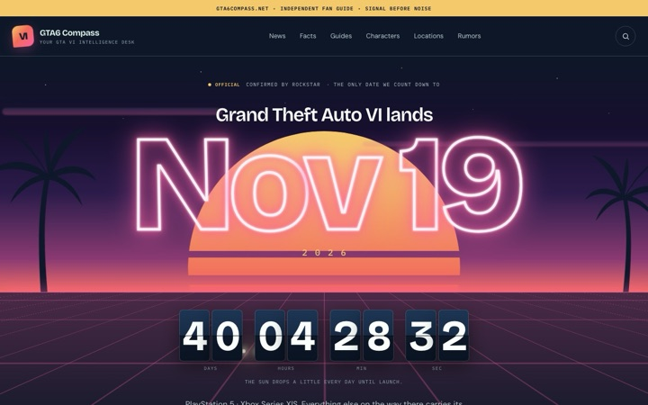
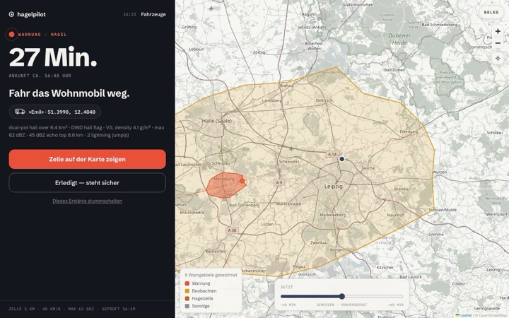
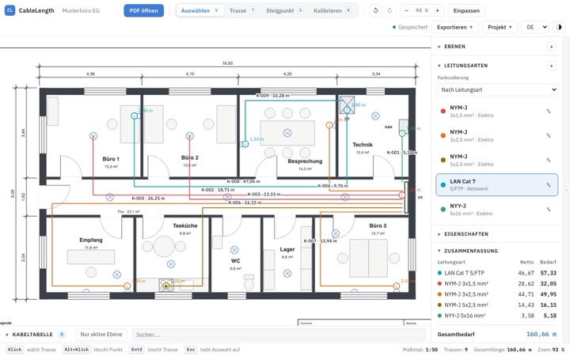
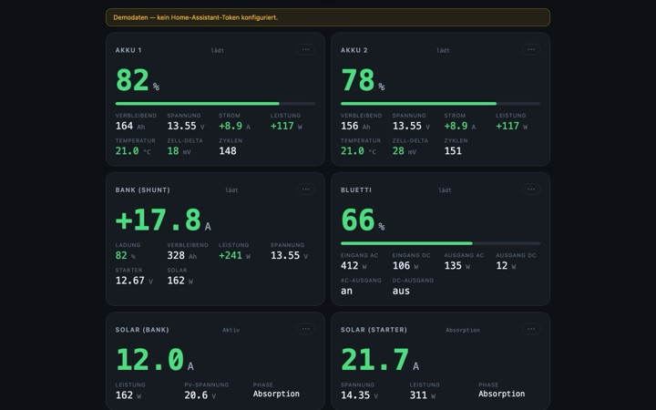

<a href="https://faulepaule.com">
  <picture>
    <source media="(prefers-color-scheme: dark)" srcset="img/banner-dark.png">
    
  </picture>
</a>

### Too lazy to do it twice.

I'm Paul. When something annoys me, I build a tool against it and run it myself: apps, web tools, games and all sorts of things for the house and the campervan. All of this is a hobby. I'm highly interested in large language models, and I use them heavily for these projects.

**All projects with pictures and short videos: [faulepaule.com](https://faulepaule.com)**

<table>
  <tr>
    <td width="33%" valign="top">
      
      <b><a href="https://rudelradar.com">Rudelradar</a></b> 
      The pack live on the map 
      Flutter · Node · Socket.IO
    </td>
    <td width="33%" valign="top">
      
      <b><a href="https://blattgefuehl.de">Blattgefühl</a></b> 
      Plant checkup by photo 
      React · PWA · Vision AI
    </td>
    <td width="33%" valign="top">
      
      <b><a href="https://gta6compass.net">GTA6 Compass</a></b> 
      Every claim with an evidence label 
      Next.js · TypeScript
    </td>
  </tr>
  <tr>
    <td width="33%" valign="top">
      
      <b>hagelpilot</b> 
      A hail alarm for your car 
      Node · PostGIS · DWD
    </td>
    <td width="33%" valign="top">
      
      <b>CableLength</b> 
      Cable metres off the PDF plan 
      React · TypeScript · pdf.js
    </td>
    <td width="33%" valign="top">
      
      <b>Vanpanel</b> 
      One dashboard for the campervan 
      React · Bluetooth · Home Assistant
    </td>
  </tr>
</table>

The repositories are private. The page shows what the projects can do; for questions, use the [contact there](https://faulepaule.com/#kontakt).
